<div align="center">

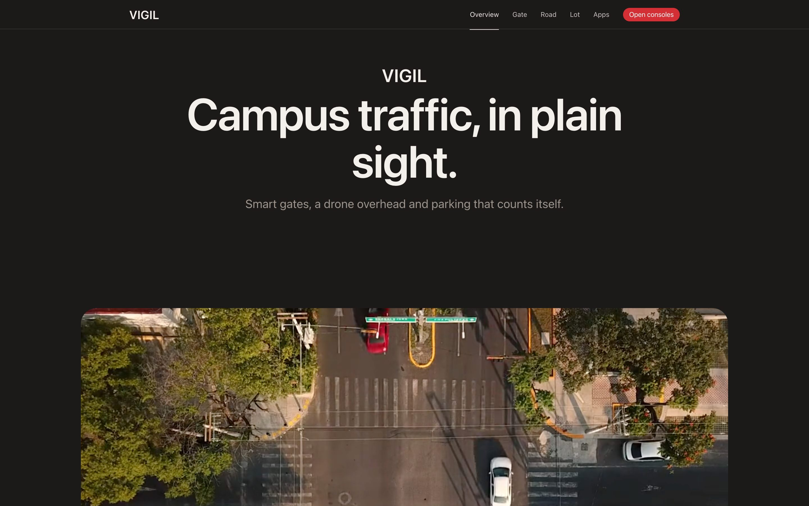

# VIGIL

### Vehicular Intelligence & Ground–UAV Integrated Logistics Systems

**Integrated campus vehicle monitoring: secure RFID–LoRa gate logging, drone-based speed estimation and smart parking.**


Capstone project · Thapar Institute of Engineering & Technology, Patiala · 2026

[Overview](#overview) · [Architecture](#architecture) · [Gate](#1-gate-rfid--lora-vehicle-logging) · [Road](#2-road-drone-based-speed-estimation) · [Lot](#3-lot-smart-parking) · [Apps](#mobile-apps) · [Results](#measured-results) · [Getting started](#getting-started) · [Team](#team)

</div>

---

## Overview

Vehicle movement on a university campus is still managed largely by hand. Guards write entries in registers at the gates, speeding on internal roads is noticed only when someone happens to see it, and drivers circle the lots looking for a free space.

**VIGIL** replaces that with three systems that each run on their own and share one secure cloud database:

| | Subsystem | What it does | Sensing | Who uses it |
|---|---|---|---|---|
| **1** | **Gate** | Logs every entry and exit with an encrypted RFID tap | ESP32 + MFRC522 reader, 433 MHz LoRa link | Security office (gate log) |
| **2** | **Road** | Measures the speed of every car from a hovering drone and pages the nearest guards when one speeds | Drone camera, RTSP over Wi-Fi | Guards (Guard Alert app), control room |
| **3** | **Lot** | Marks every parking bay free or taken, live | Fixed overhead camera or drone video | Drivers (Campus Parking app), operations |

Everything comes together in one **web console** with a slider between the three systems, and in two **Flutter apps** for iOS and Android.

> **Measured, not estimated.** Every number in this README comes from a real run of the system. See [Measured results](#measured-results).

---

## Architecture

<p align="center">
  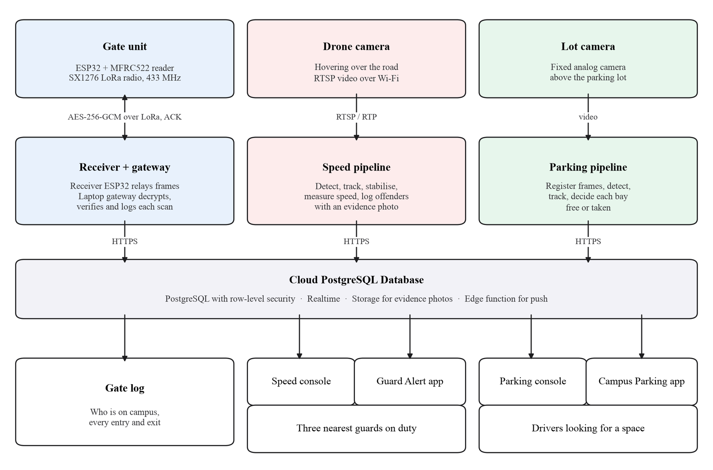
</p>

The three systems share **one PostgreSQL database** (hosted on Supabase) and nothing else. Each system owns its own tables, and row-level security is on everywhere:

| Layer | Gate | Road | Lot |
|---|---|---|---|
| **Edge** | ESP32 transmitter + receiver | Drone camera | Analog camera or drone |
| **Processing** | Laptop gateway (`rfid/gateway/gateway.py`) | Speed pipeline (`speed/live_pipeline.py`) | Parking pipeline (`parking/pipeline.py`) |
| **Storage** | `vehicles`, `tags`, `vehicle_logs`, `unauthorised_*` | `speeding_events`, `guards`, `dispatches`, evidence photos | `parking_lots`, `parking_slots`, `slot_events`, `parking_snapshots`, `cv_vehicle_log` |
| **Delivery** | Gate log console | Speed console, Guard Alert app | Parking console, Campus Parking app |

How a speeding event reaches a guard:

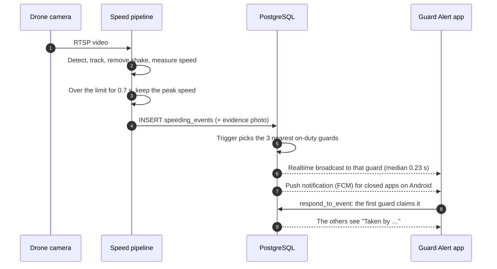

---

## The web console

One page at `http://localhost:8070` with a slider between the systems. A green dot means that system is answering. A stopped system shows how to start it, and the page picks it up again on its own. Every console has a **Download** menu that exports its data for the last day, week, month or all time, with times in IST.

<p align="center">
  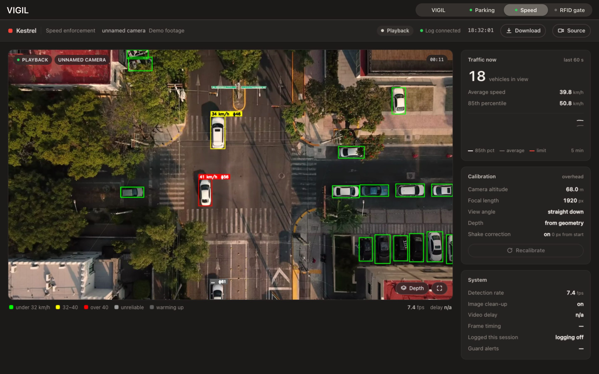
  <br><sub><b>Speed console (Kestrel).</b> Each car is boxed and labelled with its speed: green under 32 km/h, yellow 32–40, red over 40.</sub>
</p>

<p align="center">
  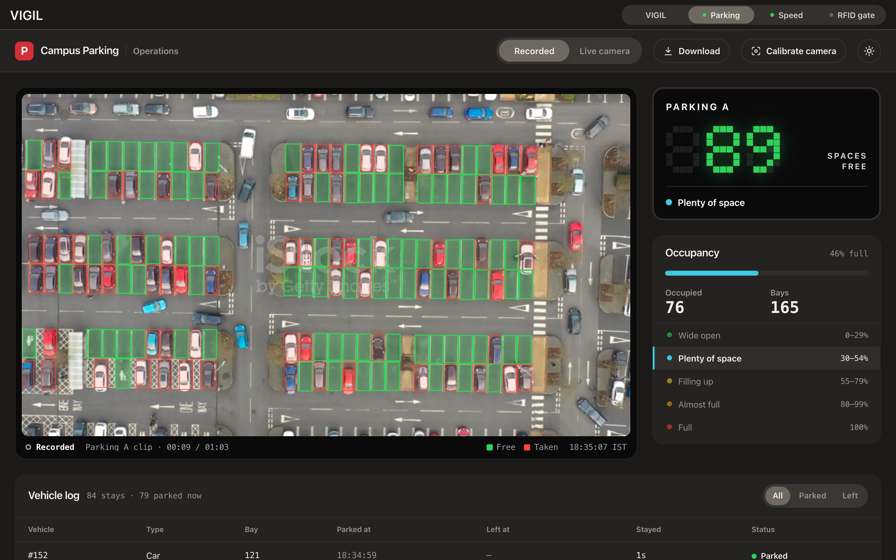
  <br><sub><b>Parking console.</b> Every bay outlined green (free) or red (taken), the lot's entrance board and the occupancy level.</sub>
</p>

The console uses its own theme in Thapar colours: a dark red taken from the institute's logo for controls, warm greys in dark mode and soft beige in light mode. The brighter system red is kept only for things that need attention, such as taken bays and speeding cars.

---

## 1. Gate: RFID + LoRa vehicle logging

Each vehicle carries **two RFID cards**, one for entry and one for exit, so direction is recorded as data instead of being guessed. An ESP32 reads the card, encrypts the identifier and sends it over a **433 MHz LoRa** link to a receiver, which relays it over USB to a laptop gateway. The gateway decrypts it, verifies it and writes it to the database. The gate's light turns green **only after the database has committed the row**.

<p align="center">
  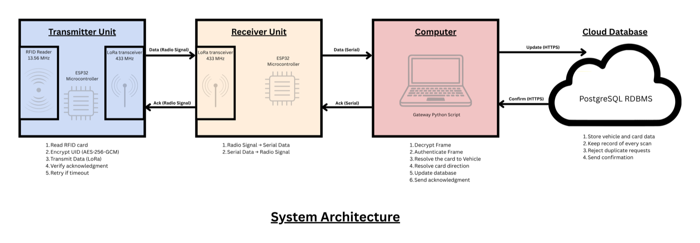
</p>

| Design choice | How it works |
|---|---|
| **End-to-end encryption** | AES-256-GCM from the ESP32 to the laptop. The receiver holds no keys and only relays frames. |
| **Authenticated header** | Frame `version · type · device_id · counter · ciphertext · tag`. The 14-byte header is the AAD. |
| **No nonce reuse** | The counter is a high-water mark in flash that jumps by 1000 on every boot. DATA and ACK frames use different nonces. |
| **Idempotent retries** | Retries reuse the same counter, and `unique (device_id, counter)` turns a duplicate into "already committed". |
| **Commit-confirmed ACK** | Statuses: `0x00` committed · `0x01` already committed · `0x02` database error, retry · `0x03` unregistered card · `0x04` enrol mode. |
| **Survives outages** | Stop-and-wait, 3 tries × 3 s, then a 30 s back-off while the reader keeps reading. Up to 8 scans wait in RAM. |
| **Two kinds of exception** | Guard *tally cards* count known unauthorised vehicles that have no tag. *Unknown cards* are logged separately as a security anomaly. |

<details>
<summary><b>Full gate flow</b> (transmitter → receiver → computer → database)</summary>
<p align="center">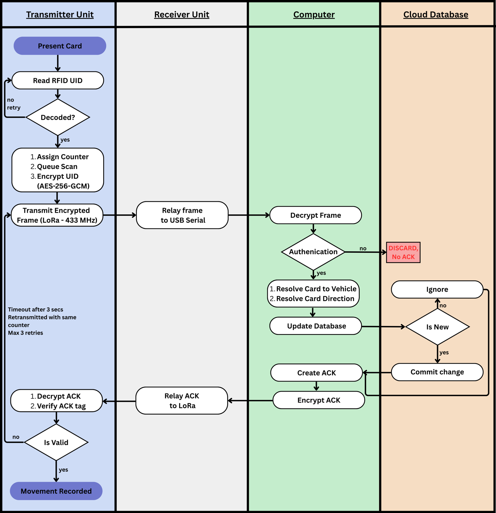</p>
</details>

Radio: SX1276, 433 MHz, SF7, 125 kHz bandwidth, CR 4/5, CRC on. Firmware is in [`rfid/transmitter`](rfid/transmitter) and [`rfid/receiver`](rfid/receiver), and the design is in [`rfid/README.md`](rfid/README.md).

---

## 2. Road: drone-based speed estimation

A drone hovers over the road and streams video to the speed pipeline. The pipeline measures speed **without any flight metadata**: it calibrates its own scale from the widths of the cars it sees.

<p align="center">
  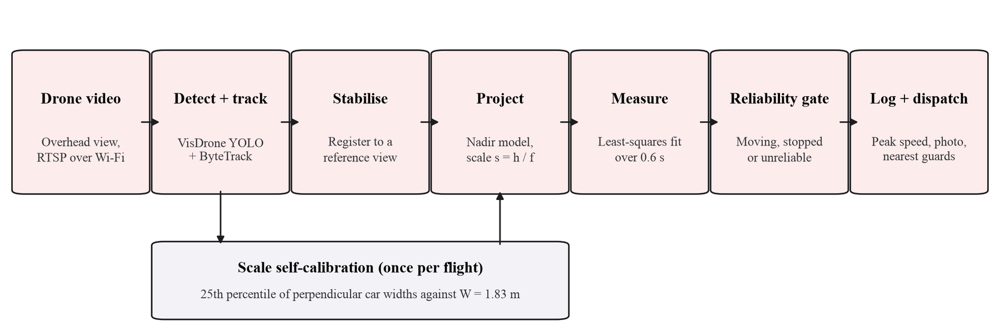
</p>

| Stage | What happens |
|---|---|
| **Detect + track** | YOLO trained on VisDrone aerial imagery finds vehicles, and ByteTrack follows them. |
| **Stabilise** | Every frame is registered to one reference view (1.7 ms per frame), so the drone's own shake does not read as vehicle motion. |
| **Self-calibrate** | Scale comes from car width (1.83 m), taken at the 25th percentile of measured widths. That percentile is robust to boxes that only ever inflate. |
| **Measure** | Least-squares velocity fit over about 0.6 s, using the camera's own RTP timestamps once they can be trusted. |
| **Reliability gate** | A reading must clear 2σ of the measured noise, or it is labelled `UNRELIABLE` instead of reported. Stopped cars read `0.0 (stopped)`. |
| **Log + dispatch** | Over the limit **continuously for 0.7 s** → one event with the **peak** speed and an evidence photo. It is saved locally first, then synced to the cloud, which alerts the 3 nearest guards. |

<p align="center">
  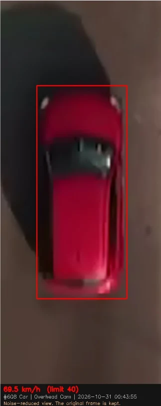
  <br><sub>The evidence photo saved with a real speeding event.</sub>
</p>

The drone's Wi-Fi carries the video, so the internet often isn't available. That's why every event is written to a **local SQLite copy first**, and a sync thread pushes it to the cloud when it can. Details and every design decision (including what failed) are in [`speed/README.md`](speed/README.md) and [`speed/METHODOLOGY.md`](speed/METHODOLOGY.md).

---

## 3. Lot: smart parking

A fixed camera (or a drone) watches the lot. Each frame is registered to the lot's reference image, and each marked bay is then decided free or taken.

<p align="center">
  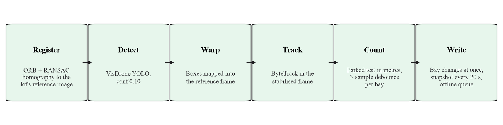
</p>

| Stage | What happens |
|---|---|
| **Register** | ORB + RANSAC homography maps every frame onto the lot's reference image, with vehicles masked out. |
| **Detect + warp** | VisDrone YOLO boxes are mapped into the reference frame, so the bay outlines always line up. |
| **Track + count** | ByteTrack in the stabilised frame, so a parked car is truly still. "Parked" is a displacement test, and a bay changes state only after consistent samples. |
| **Write** | State changes are written at once, with a snapshot every ~20 s and an offline queue that drains on reconnect. Never written per frame. |
| **Camera off** | The analog camera cools down every few minutes. A black frame holds every bay's last state instead of emptying the lot. |

Lot status, shown on the console, the entrance board and the app:

| Level | Wide open | Plenty of space | Filling up | Almost full | Full | No live data |
|---|---|---|---|---|---|---|
| **Occupancy** | 0–29 % | 30–54 % | 55–79 % | 80–99 % | 100 % | no update for over 2 min |

Bays are marked in the browser: grab a clear frame, drag a box per bay, drag its corners onto the paint, then mark one ground rectangle in metres. The demonstration lot has **165 bays**. More in [`parking/README.md`](parking/README.md).

---

## Mobile apps

Two Flutter apps for **iOS and Android**. They share one login system with row-level security, so a user can only read what their role allows.

<table>
  <tr>
    <td width="50%" align="center">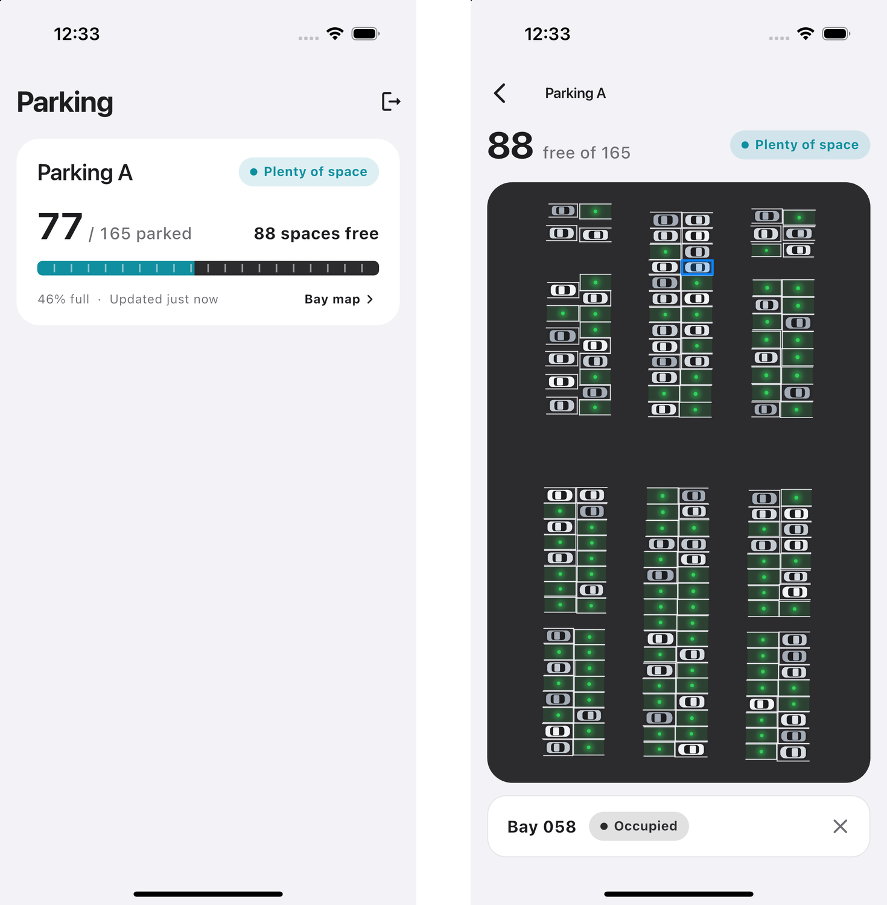</td>
    <td width="50%" align="center">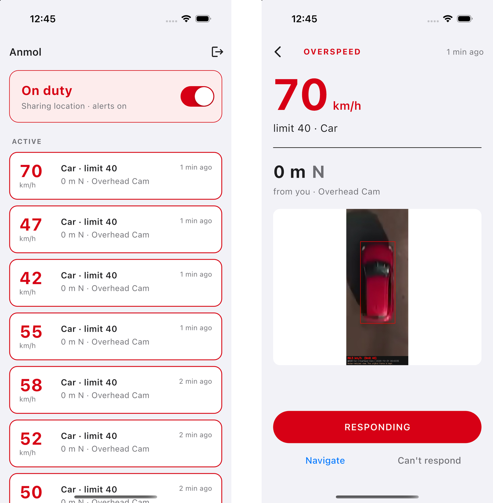</td>
  </tr>
  <tr>
    <td valign="top">
      <h3>Campus Parking</h3>
      For drivers: check for a space before setting off.
      <ul>
        <li>Live occupancy for each lot, refreshed in real time</li>
        <li>Bay map with taken bays drawn as cars from above</li>
        <li>Sign up, sign in and password reset by emailed code</li>
      </ul>
    </td>
    <td valign="top">
      <h3>Guard Alert</h3>
      For guards: the nearest guard hears about speeding first.
      <ul>
        <li>On-duty toggle that shares the guard's location</li>
        <li>Alerts by realtime broadcast, plus push notifications on Android</li>
        <li>One tap claims an alert, and Navigate opens directions</li>
        <li>Campus-email sign-up; a supervisor grants guard access</li>
        <li>Light and dark mode</li>
      </ul>
    </td>
  </tr>
</table>

---

## Measured results

From the project report and the systems' own test logs.

| System | Measurement | Result |
|---|---|---|
| **Gate** | Tap to committed database row | **0.6 s** median (n = 27) |
| **Gate** | AES-256-GCM encryption on the ESP32 | **0.07 ms** |
| **Gate** | Scans lost through a two-minute total outage of the gateway link | **0** |
| **Gate** | Tally or unknown cards misclassified, across 65 presentations | **0** |
| **Gate** | LoRa airtime, measured against computed (34-byte frame) | 78.0 ms vs 77.1 ms (**1.2 %**) |
| **Road** | Median speed error on footage with the drone's shake | **3.3 → 0.6 km/h** with motion compensation |
| **Road** | Parked cars given a false speed of 5 km/h or more | **54 % → 5 %** |
| **Road** | 90th-percentile error caused by frame timing, with Wi-Fi-like delays | **3.94 → 0.02 km/h** using camera timestamps |
| **Road** | Parked cars tracked for 29 s | read **0.05–0.38 km/h** (true value: 0) |
| **Road** | Lane width recovered by calibration | **3.85 m, 3.67 m** (true value: 3.7 m) |
| **Road** | Detection recall with frame clean-up | **76 % → 84 %** |
| **Road** | Detection speed, yolo11s at 1280 px (Apple M4 Pro, MPS) | **34.1 fps** |
| **Alerts** | Speeding event to the guard's phone | **0.23 s** median |

---

## Getting started

### Requirements

| Tool | Used for |
|---|---|
| macOS (Apple Silicon recommended) | Launchers are `.command` files; the vision models run on MPS |
| Python 3.13 | All three pipelines and the gate gateway |
| Flutter (stable), Xcode, Android SDK + JDK 17 | The two apps |
| Arduino IDE with the ESP32 core | Gate firmware (MFRC522 and LoRa libraries) |
| A Supabase project | The shared PostgreSQL database, login, realtime and storage |

```bash
python3 -m pip install ultralytics supervision trackers supabase numpy pyyaml opencv-python \
  torch transformers yt-dlp "psycopg[binary]" python-dotenv requests pyserial cryptography httpx
```

### Configuration

No secrets are in this repository. Create these files from the examples next to them:

| File | Contents |
|---|---|
| `speed/.env` | Database URL and service key (see `speed/.env.example`) |
| `parking/.env` | `SUPABASE_URL`, `SUPABASE_SERVICE_KEY` |
| `rfid/gateway/.env` | Gate pre-shared key and database keys (see `.env.example`) |
| `rfid/transmitter/secrets.h` | The same pre-shared key for the ESP32 (see `secrets.h.example`) |
| `mobile/campus_parking/env.json` | Supabase URL and publishable key (see `env.example.json`) |
| Guard Alert Firebase config | `google-services.json` and `GoogleService-Info.plist` from your Firebase project |

### Run everything

```bash
open "Start VIGIL Capstone.command"
```

This starts all three systems and opens the console. Each system also runs on its own:

| System | Launcher | Address |
|---|---|---|
| Combined console | `Start VIGIL Capstone.command` | http://localhost:8070 |
| Parking | `parking/Launch Parking System.command` | http://127.0.0.1:8080 |
| Speed (Kestrel) | `speed/Start Vehicle Monitor.command` | http://localhost:8000 |
| Gate log | `rfid/Start VIGIL.command` | http://localhost:8777 |

The gate log works without hardware; the gateway that writes new scans starts when both ESP32 boards are plugged in. The speed console waits for the drone's camera and offers recorded demo footage otherwise.

### Run the apps

```bash
cd mobile/campus_parking && flutter run --dart-define-from-file=env.json   # Campus Parking
```

```bash
cd mobile/guard_app && flutter pub get && flutter run                      # Guard Alert
```

Guard access is granted by a supervisor:

```bash
python3 speed/guards_admin.py add --email name@thapar.edu --name "Guard Name"
```

---

## Repository structure

```
VIGIL_Capstone/
├── Start VIGIL Capstone.command   one-click launcher for everything
├── web/                           combined console and the VIGIL guide page
├── rfid/                          1 · Gate
│   ├── transmitter/               ESP32 + MFRC522 + LoRa firmware
│   ├── receiver/                  ESP32 LoRa ↔ USB relay (holds no keys)
│   ├── gateway/                   decrypts, verifies, commits, sends the ACK
│   ├── dashboard/                 gate log console
│   └── testing/                   bench harness and measured findings
├── speed/                         2 · Road
│   ├── speedcam.py                geometry, velocity fit, motion compensation
│   ├── calibrate.py               scale self-calibration
│   ├── live_pipeline.py           server and Kestrel console
│   ├── speedlog.py                local-first speeding log and cloud sync
│   └── supabase/                  guard dispatch trigger and push function
├── parking/                       3 · Lot
│   ├── pipeline.py                register → detect → warp → track → count
│   ├── occupancy.py               parked test and bay debounce
│   ├── dashboard_server.py        parking console and calibration page
│   └── lots/                      bay layouts
├── mobile/
│   ├── campus_parking/            Flutter app for drivers
│   └── guard_app/                 Flutter app for guards
├── report/                        capstone report and final review deck
├── poster/                        project poster
└── docs/images/                   images used in this README
```

---

## Privacy by design

- **No plates from the air.** The drone and the lot camera count anonymous vehicles; they never read number plates.
- **Two logs, kept apart.** The gate log knows *which* car came in. The cameras only know *that* a car is there. Matching them by timing would be guesswork, so they are never joined.
- **Least privilege.** Row-level security is on for every table. The apps ship only a publishable key, and backend writers keep their service keys in local `.env` files.
- **Campus only.** Only accounts with a campus email address can be guards, and a supervisor has to grant access.

---

## Documentation

| Document | What's in it |
|---|---|
| [`rfid/README.md`](rfid/README.md) | Gate protocol, wiring and security design |
| [`rfid/testing/results/FINDINGS.md`](rfid/testing/results/FINDINGS.md) | Every gate measurement, phase by phase |
| [`speed/README.md`](speed/README.md) | Speed pipeline, accuracy, performance and guard alerts |
| [`speed/METHODOLOGY.md`](speed/METHODOLOGY.md) | Every design decision, including the ones that failed |
| [`parking/README.md`](parking/README.md) | Parking pipeline, cameras, calibration and tables |
| [`mobile/campus_parking/README.md`](mobile/campus_parking/README.md) · [`mobile/guard_app/README.md`](mobile/guard_app/README.md) | The two apps |
| [`report/VIGIL_Capstone_Report.docx`](report/VIGIL_Capstone_Report.docx) | The full capstone report |

---

## Team

| | |
|---|---|
| **Students** | Anmol Mangat · Khushi Garg · Ishita Vaid · Ishaan Singh |
| **Supervisor** | Dr. Sudhanshu Tyagi, Department of Electronics and Communication Engineering |
| **Institute** | Thapar Institute of Engineering & Technology, Patiala |

We thank the Department of Electronics and Communication Engineering at TIET for the laboratory facilities and the opportunity to build this project.

### Media and data notes

The parking demonstration clip is a stock-footage preview and the road test clips include third-party videos. Both are used here for demonstration and testing only, and belong to their owners. No licence has been chosen for this repository yet, so all rights are reserved by the authors.
